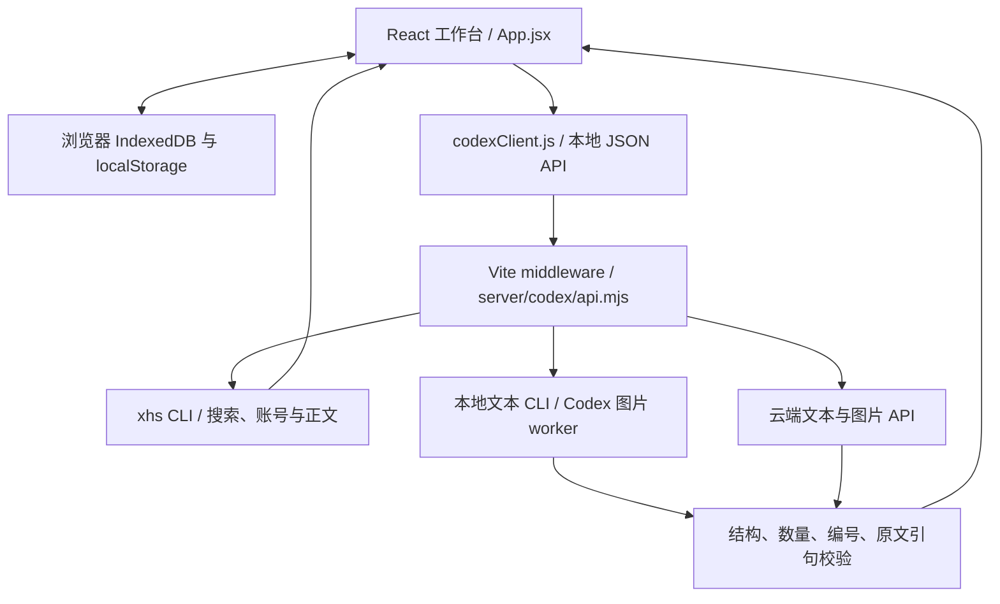

# 小红书创作站开发指南

开发前先读 [AGENTS](../AGENTS.md) 与 [TASK_STATE](../TASK_STATE.md)。本文件解释运行机制和验证方法；产品规则以 [SPEC](SPEC.md) 为准，用户操作见 [USER_GUIDE](USER_GUIDE.md)，历史结果见 [归档](archive/QA_LOG.md)。

## 1. 架构与请求流

项目使用 React 19 + Vite 6。浏览器管理界面和本地工作区，Node middleware 执行受控 CLI 或转发云端模型请求；没有独立的远端业务数据库。

`vite.config.mjs` 在开发服务与构建预览中都挂载 `codexGenerateMiddleware`；仅把 dist 放到普通静态托管不能提供 CLI / 模型接口。请求 JSON 按完整 UTF-8 字节解码，上限 512 KiB。

“热门参考 / RAG”当前是每稿保存的参考条目（内部字段 `ragItems`）进入模型上下文，没有另建向量数据库。账号分析则先读选中作品形成候选；确认后写作只使用正式版本快照，不发送整个样本库。提示词把素材和参考作为待处理内容，不将其中的指令当作工具授权。

## 2. 代码地图

| 范围 | 主要文件 / 目录与职责 |
| --- | --- |
| 页面与交互编排 | `src/main.jsx`、`src/App.jsx`：入口、阶段状态、自动化、模型配置与预览 |
| 账号界面 | `src/AccountPanel.jsx`、`src/AccountReview.jsx`、`src/AccountAvatar.jsx`：读取确认、审核表单、真实头像与占位 |
| 素材、参考、项目列表 | `src/MaterialsPanel.jsx`、`src/ReferenceLibrary.jsx`、`src/ProjectLibrary.jsx` |
| 浏览器存储 | `src/useWorkspace.js`、`src/workspaceStore.js`、`src/accountStore.js` |
| API 客户端 | `src/codexClient.js`：路由选择、JSON 请求、结构化错误及旧后台识别 |
| 创作上下文 | `shared/workflow.mjs`：素材导入、限制、签名、成稿导出；`shared/project.mjs`：项目快照字段白名单 |
| 正文与删除恢复 | `shared/noteDetails.mjs`、`shared/references.mjs`：串行读取、来源 / 原文备份、删除参考与恢复 |
| 账号模型 | `shared/account.mjs`：选样、分析输入 / 引文校验、候选 / 正式版本、快照；`shared/accountIdentity.mjs`：名称与公开头像归一化 |
| 品牌与兼容 | `shared/branding.mjs`、`shared/legacyCompatibility.mjs`、`shared/modelTiming.mjs` |
| 本地 API 与提示词 | `server/codex/api.mjs`、`server/codex/prompts.mjs`、`server/codex/validation.mjs`：分发、统一上下文、输入与输出校验 |
| 模型执行 | `server/codex/runCodex.mjs`、`server/codex/cloudProvider.mjs`、`server/codex/coverImage.mjs` |
| CLI 适配 | `server/localCli/registry.mjs`、`server/localCli/commandPaths.mjs`、`server/localCli/inputBudget.mjs`：能力、路径、参数容量 |
| 小红书读取 | `server/xhs/runXhs.mjs`、`server/xhs/account.mjs`：搜索 / 详情、资料 / 分页 / 本人作品读取 |
| 启动与探测 | `scripts/start-fixed.mjs`、`scripts/serviceProbe.mjs` |
| 样式与资产 | `src/styles.css`、`public/assets/`，规则见 [DESIGN](DESIGN.md) |

## 3. 本地启动与路径解析

在仓库根目录执行，先准备 Node.js / npm；直接用 Vite 命令前运行 `npm install`，启动器会自动补装缺少的依赖。

| 命令 | 用途 |
| --- | --- |
| `npm run launch:fixed` | 构建后在固定 52880 端口预览，自动打开浏览器 |
| `npm run launch:dev` | 同一固定地址的开发模式 |
| `npm run dev:fixed` | 直接启动固定地址开发服务 |
| `npm run build` | 生成 dist 并检查构建 |
| `npm run preview:fixed` | 预览已有 dist |
| `npm run deploy:local` | 构建并本地预览，不是远端部署 |
| `npm test` | 离线回归套件 |

正常使用保持 `http://127.0.0.1:52880`。调试启动器可用 `node scripts/start-fixed.mjs --dev --no-open --port 52881`，只测试独立实例，不操作用户原服务；测试端口有自己的浏览器存储。

启动器先检查固定地址的页面标题、正文 / 账号接口和运行时版本，兼容才复用。缺少路由、返回旧时限或资料版本时提示停止旧后台，不自动结束进程。启动和路径查找不调用 xhs / 模型或 CLI 版本检测；`--version` 只在用户点检测时运行。启动器负责自己服务的 q + Enter / Ctrl+C 退出。

Windows 通过 Node 运行 npm / Vite 的 JavaScript 入口，不能以 `shell: false` 直接启动 npm.cmd。统一路径解析优先尊重以下覆盖，再查 PATH / 安装位置；支持 npm Codex 原生平台可执行文件和 uv 的用户 .local/bin。

| 环境变量 | 覆盖对象 |
| --- | --- |
| `CODEX_CLI_PATH` | Codex 可执行文件 |
| `KIMI_CLI_PATH` | Kimi 可执行文件 |
| `CLAUDE_CLI_PATH` | Claude 可执行文件 |
| `XHS_CLI_COMMAND` | xhs 可执行文件 |

PowerShell 示例：`$env:CODEX_CLI_PATH = 'C:\Tools\codex.exe'`，然后运行启动命令。macOS / Linux 可用 `CODEX_CLI_PATH=/path/to/codex npm run launch:fixed`。这只是当前进程配置，不应修改系统 PATH 或用户登录凭据。

## 4. 本地 API 索引

除运行时探测和图片资源外，业务接口均为 POST JSON；对 POST 路由发 GET 返回 405 / `METHOD_NOT_ALLOWED`，不会执行 CLI。

| 路由 | 职责 |
| --- | --- |
| `GET /api/runtime` | 只读返回应用标识、模型时限和账号资料版本 |
| `/api/xhs/search`、`/api/xhs/read` | 搜索与所选热门笔记文字正文 |
| `/api/xhs/account/profile`、`/api/xhs/account/posts`、`/api/xhs/account/read` | 账号资料、作品分页、所选账号作品正文 |
| `/api/local-cli/detect` | 用户主动检测 CLI 版本与能力 |
| `/api/local-cli/generate`、`/api/local-cli/decide`、`/api/local-cli/cover-image` | 通用本地生成、决策、图片 |
| `/api/cloud/generate`、`/api/cloud/decide`、`/api/cloud/cover-image` | 云端生成、决策、图片 |
| `/api/codex/generate`、`/api/codex/decide`、`/api/codex/cover-image` | 保留的 Codex 兼容路由 |
| `GET /generated/covers/*.png` | 校验后的临时 PNG 文件 |

当前运行时响应为 `{ok:true, app:"xiaohongshu-creator-station", modelTimeoutMs:900000, accountProfileVersion:2}`。探测只访问本地，不检测 CLI、不读取凭据或访问平台。

生成请求的 `kind`：materials、accountAnalysis、referenceAnalysis、topics、drafts、draftReview、coverPrompts。常用创作上下文字段包括 persona、keyword、writingBrief、mustInclude、sourceMaterials、materialSummary、ragItems、referenceAnalysis、accountProfile；不同任务另有选题、文案或账号分析输入，以 validation 和客户端调用为准。

决策请求使用 `decisionKind`（rag / topic / draft / coverPrompt）与候选 `options`，携带相同创作上下文；服务端校验所选 ID、去重与数量。决策结果包含 selectedIds、reason；生成结果与决策均附通道 / 命令摘要、耗时和时间。错误采用 `{ok:false, code, error}`，必要时带脱敏 details，不能依赖 HTTP 200 判断业务成功。

校验层保留固定候选数量、必需字段、素材 / 参考编号、账号证据与原文连续引句校验。本地输出兼容部分中英文 / snake_case 字段别名；缺少 coverDirection 可补静物方向，不放松正文、话题和数量约束。非规范本地输出使用 `LOCAL_CLI_BAD_JSON`。

## 5. CLI、云端与读取约定

### 文案与图片模型

Codex 文本通过 UTF-8 stdin 传完整提示词，使用只读 sandbox，读取最终结构化输出；模型别名留空沿用默认，合法 ID 仅以 -m 覆盖本次文本模型。Claude 使用非交互 JSON 模式，正文走 stdin，带 `--safe-mode --tools "" --no-session-persistence`，解析 result 字段。

Kimi 与自定义适配器走参数协议，启动前检查平台参数预算，超限报 `LOCAL_CLI_INPUT_TOO_LARGE`，不能截断。stdout / stderr 使用 UTF-8 流式解码，避免跨块中文损坏；不因一个 CLI 失败静默换用另一通道。文本、决策和 Codex 封面 worker 都沿用用户推理配置。

自定义 CLI 的 XHS Creator Station print protocol：

- 接受 `--version`；生成接受 `--prompt <完整提示词>`、`--output-format stream-json`、可选 `--model <模型别名>`。
- stdout 为逐行 JSON，最终至少一条 `{"role":"assistant","content":"<符合当前任务结构的 JSON 字符串>"}`。
- stderr 可输出进度，不承载最终结果。命令填 PATH 名称或可执行文件绝对路径，不是 shell 命令片段。
- 接入其他调用规范时在 registry 中新增适配器并声明 text / image 能力；当前 Codex 支持文本和图片，Kimi / Claude / 自定义规范 CLI 仅支持文本。

云端文字走 OpenAI-compatible `POST /chat/completions`，图片走 `POST /images/generations`。Kimi 官方 Moonshot 域名与 api.kimi.com/coding 分支不固定 temperature，使用 max_completion_tokens 与 json_object；上游错误保留脱敏的具体原因。此处描述兼容策略，不保证供应商所有模型可用。

本地图片由 Codex native imagegen worker 生成，云端图片下载后同样检查 PNG 签名；统一临时托管，草稿保存时备份 Blob。临时缓存不是永久备份，清理仅限自身缓存目录。

### 小红书搜索与正文

所有调用均为参数数组、`shell: false`，默认 `--cookie-source none` 使用 CLI 自己保存的登录态；可用服务进程环境变量 XHS_COOKIE_SOURCE 配置来源，应用不读取登录缓存内容。

热门搜索采用 `search <关键词> --sort popular --type all --page 1 --json`；详情 API 只接受有效 24 位十六进制 noteId，纯数字编号转为固定域名笔记 URL，避免被 CLI 误当列表序号。兼容 feed 和 HTML 回退的 note 对象，校验编号，非空文字正文才算成功。

账号适配器用 `user` / `user-posts` 读资料和作品；所选作品读取前刷新 CLI 对应列表，再用其列表序号和内部访问上下文，核对笔记及可得作者编号，防止别的标签覆盖列表而关联错文。

只返回白名单业务资料，账号公开头像需 HTTPS / 域名 / 凭据过滤；不把 Cookie、xsec_token、原始 CLI 输出或 traceback 送到浏览器。仅设置子进程 `PYTHONIOENCODING=utf-8`，不强制 PYTHONUTF8=1 改变 Windows 旧 GBK 缓存的文件编码。

区分缓存解码、标准流编码、Python 依赖、异常退出、未登录、验证、限流和真正的非 JSON 错误。不要把所有失败都改成 XHS_BAD_JSON；客户端发现旧后台 404 / HTML 回退时提示重启并停止本批读取。

### 超时来源

| 操作 | 上限 / 来源 |
| --- | --- |
| 所有单次模型生成、分析、决策与封面生成 | 15 分钟，`shared/modelTiming.mjs` |
| xhs 单次命令 | 60 秒，输出总量最多 4 MiB |
| CLI 版本检测 | 5 秒 |
| 云端图片文件下载 | 5 分钟，独立于图片生成等待 |

## 6. 存储、版本与兼容

历史标识集中于 `shared/legacyCompatibility.mjs`，不可按新品牌直接重命名：

| 内容 | 存储标识与实现 |
| --- | --- |
| 全局模型与旧偏好 | localStorage 前缀 `mint-atelier-v2` |
| 草稿数据库 | IndexedDB `mint-atelier-workspace-v1`，版本 1，projects / index stores |
| 当前草稿 ID | localStorage `mint-atelier-v3:active-project` |
| 账号数据库 | IndexedDB `mint-atelier-accounts-v1`，版本 1，accounts store |
| 临时封面缓存目录名 | `xhs-g4-generated-covers` |

useWorkspace 在编辑后约 700ms 防抖保存，新建 / 切换前等待保存并加操作锁。projectSnapshot 白名单包含流程内容、accountSnapshot、accountMode、deletedReferences，不含模型配置。草稿与索引在写事务完成后才报成功；deletedAt 软删除与索引原子更新，迟到保存不能复活，最后一稿删除后不自动创建空稿。

参考删除保存完整条目与原顺序，取消搜索勾选、清理旧分析；恢复去重并校验预算。PNG 备份失败保留文字并报告部分保存。

账号 saveAccount 在同一事务写入 primary 和账号 userId 两份索引记录，白名单只含资料、目标、事实、样本、候选、正式版本及分页状态。确认版本先落盘再启用；原文备份和账号库不整体进入写作请求，accountInput 排除头像 URL。

输入签名用于判断摘要、参考分析、核对和生成结果是否过期，不是安全校验。资料恢复不自动生成新项目；旧 localStorage 人设等只用于首次兼容，旧内存数据无法恢复。存储按浏览器 origin 隔离，不是仓库文件，也无云同步。

## 7. 验证与问题定位

验证方法保持在这里；具体日期、结果、未完成事项写 TASK_STATE，长历史放归档。

### 离线与构建

按变更范围运行 `npm test`、`npm run build` 和 `git diff --check`。纯文档检查结构、所有相对链接与已移除路径；不需要为改文案新增实现镜像式测试。

| 变更范围 | 重点回归 |
| --- | --- |
| 素材、上下文、输出 | materials、workflowApi、textInput：完整原文、引文、预算、编号与数量 |
| 正文、搜索、账号 CLI | runXhs、account、noteDetails：编码、身份、串行、局部失败与全局停止 |
| 账号版本与头像 | shared/account、accountIdentity、accountStore、accountReview：候选过期、确认事务、旧稿快照、显示状态 |
| 草稿与删除 | workspaceStore、references：保存失败、软删除、迟到写入、刷新恢复与预算 |
| 通道与启动 | cloudProvider、taskTimeout、commandPaths、codexClient、serviceProbe：协议、15 分钟、路径与旧后台 |

套件使用模拟子进程 / fetch / 数据库及虚拟计时，不访问真实小红书或付费模型。组件静态渲染只证明对应 HTML 状态，不能替代真实点击、Console 或网络图片加载。

### 本地服务探测

独立测试实例启动后可用 PowerShell `Invoke-RestMethod http://127.0.0.1:52881/api/runtime` 检查身份与版本。GET /api/xhs/read 和 GET /api/xhs/account/profile 应返回 405 JSON；404 或 HTML 回退说明不兼容。这类只读探测不执行 CLI。

另测重复启动复用、旧版拒绝、缺依赖安装和退出。只停止自己创建的测试服务，不终止用户的 52880 实例；实际模型 / 平台 smoke 不应混入启动检查。

### 浏览器与真实联调

在获准可用的浏览器中，按任务验证以下相关场景并记录证据：

1. 1440×900 及较矮视口三栏独立滚动、按钮 / 长昵称完整、资源和底部内容可见，无 React / Vite 覆盖层；检查 Console error / warn。
2. 账号读取预览 → 确认身份 → 选样读正文 → 审核候选 → 确认正式版 → 改输入使候选过期 → 新旧草稿版本与切换恢复；另查真实头像请求与占位。
3. 个人素材导入含中文、emoji 与末尾文字，超限不丢失；搜索勾选后只读所选正文，核对末尾、失败重试 / 手补、无正文阻止后续。
4. 10 选题 → 5 文案 → 编辑 / 素材核对 → 复制导出；封面可选，图片失败不丢 Prompt；自动化中断保留阶段结果且无后台重试。
5. 刷新恢复输入、候选、封面；删除当前 / 非当前 / 最后一稿，撤销和刷新后恢复；参考删除取消勾选并可恢复；保存失败不报成功。

真实搜索、读取和模型调用只在用户主动授权相应操作时执行。浏览器工具权限受阻时，记录明确未验证范围，不以其他途径绕过；历史截图或离线成功不替代本次检查。用户侧恢复步骤见 [使用指南](USER_GUIDE.md) 的常见问题。
